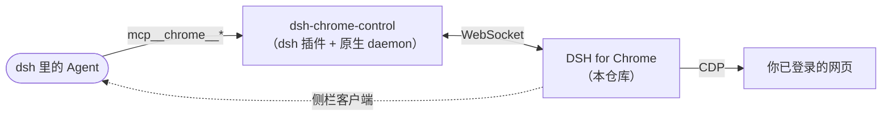
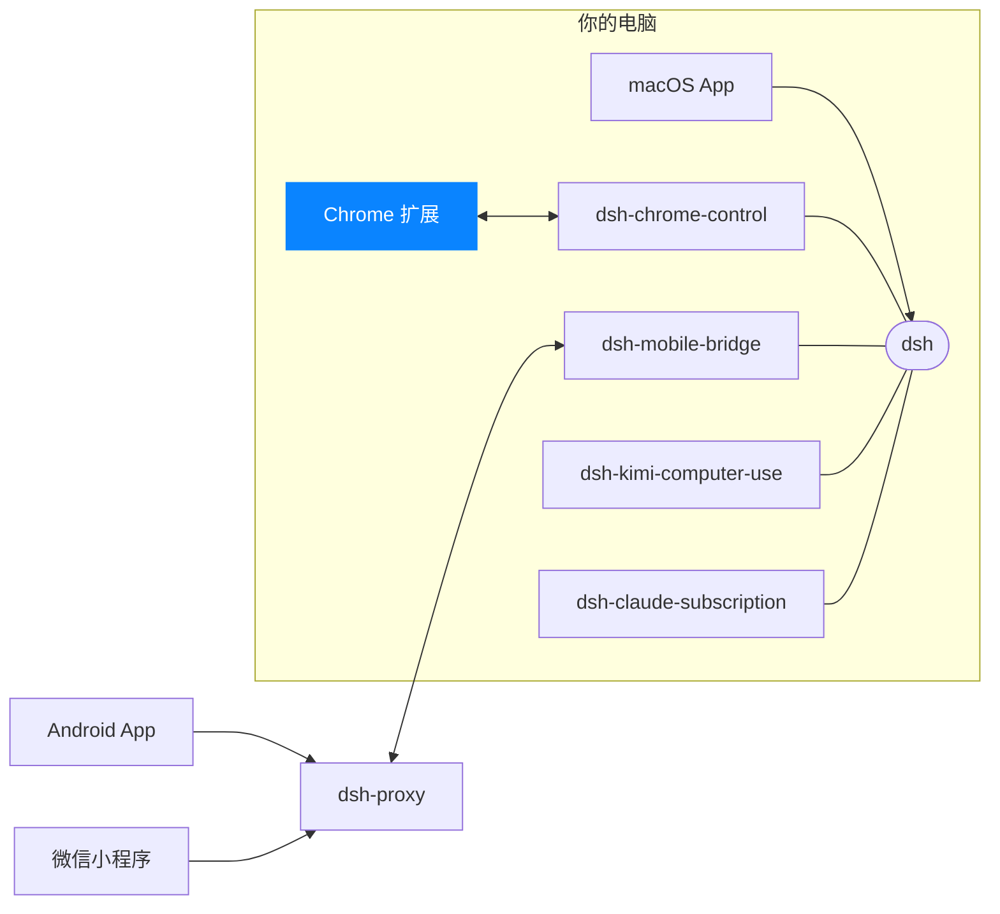

<p align="center">
  
</p>

<h1 align="center">DSH for Chrome</h1>

<p align="center">
  <b>让 DSH 用上你已登录的 Chrome，并在浏览器侧栏里直接使用 DSH</b><br>
  复用登录态 · 后台执行不打扰 · 圈选元素 + 批注 · 侧栏即完整客户端
</p>

<p align="center">
  <a href="https://chromewebstore.google.com/detail/deepseek-harness-app/kgjjicancjnedmappjhefngdjaommpop"></a>
  
  
  
</p>

<p align="center">
  <a href="https://dshapp.github.io/products/chrome/">产品介绍</a> ·
  <a href="https://dshapp.github.io/docs/install-chrome/">安装说明</a> ·
  <a href="https://dshapp.github.io/docs/browser-tools/">浏览器工具</a> ·
  <a href="https://dshapp.github.io/docs/element-picker/">圈选元素</a> ·
  <a href="https://dshapp.github.io/whatsnew/#chrome">更新日志</a>
</p>

<p align="center">
  
</p>

Agent 进不了要登录的网站；Playwright 一类方案开的是干净浏览器，每个站点都得重新登录；想指给它页面上的某个元素，只能截图、描述位置、复制选择器……
**DSH for Chrome 让 Agent 直接用你日常的那个 Chrome**——同一个配置文件、同一批登录态与已打开的标签页，Cookie 不离开浏览器。

## 亮点

- **复用你的登录态** —— 公司后台、内部系统、需要二次验证的站点直接可用；Cookie 留在浏览器里，不上传。
- **后台执行，不打扰你** —— 真实点击与键盘输入在后台标签页进行，不切走你正在看的页面；优先复用已打开的页面，任务结束不关你的标签页。
- **27 个浏览器工具** —— 导航与标签页、无障碍快照与正文提取、点击填表上传、截图与 PDF、网络请求、执行脚本——以 `mcp__chrome__*` 交给 Agent。
- **圈选元素 + 批注** —— 在页面上圈出元素、写一句要求，元素信息直接进对话；也可以把当前页面作为上下文带进去。
- **侧栏即 DSH 客户端** —— 会话与对话、Git 分支与改动、插件管理、后台任务与子代理，看网页时不用切窗口（⌘⇧D / Ctrl+Shift+D）。
- **能唤醒 dsh** —— dsh 没在运行时，扩展通过本地启动器把 `dsh web` 拉起来。

<p align="center">
  
</p>

## 由两部分组成



| 组件 | 作用 | 获取 |
| --- | --- | --- |
| **Chrome 扩展**（本仓库） | 在你的 Chrome 里执行操作，并提供侧栏里的 DSH 客户端 | [Chrome 应用商店](https://chromewebstore.google.com/detail/deepseek-harness-app/kgjjicancjnedmappjhefngdjaommpop)（「DeepSeek Harness APP」） |
| [dsh-chrome-control](https://github.com/dshapp/dsh-chrome-control) | 装在 dsh 里，把浏览器能力发布为 `mcp__chrome__*` 工具，并注册本地启动器 | `dsh plugin --profile web add dsh-chrome-control` |

浏览器控制需要两者配合；只装扩展也能把侧栏当作 DSH 客户端用。

## 安装

- **用 [Mac App](https://github.com/dshapp/dsh-macapp)**：打开「设置 → 浏览器」，缺什么点一下就装好，再从应用商店添加扩展，显示「已连接」即可。
- **不用 Mac App**（macOS / Linux）：一条命令检查并安装 Node.js、pnpm、dsh 与插件：

  ```bash
  curl -fsSL https://dshapp.github.io/install/chrome.sh | bash
  ```

  Windows 与手动安装步骤见 [安装 Chrome 扩展](https://dshapp.github.io/docs/install-chrome/)。

扩展默认连接本机的 `http://127.0.0.1:3080`。不想让 Agent 碰浏览器时，在 Chrome 里停用扩展即可；从 profile 移除插件则彻底关闭浏览器工具。

## 开发

扩展没有构建步骤，工作区里的文件就是运行时文件。

1. 打开 `chrome://extensions` → 开启「开发者模式」→「加载已解压的扩展程序」→ 选择本仓库根目录。
   `manifest.json` 里带着商店公钥 `key`，所以解压版的扩展 ID 与商店版相同，[dsh-chrome-control](https://github.com/dshapp/dsh-chrome-control) 的本地启动器与 daemon 都认它。
2. 改完在扩展页点刷新即可。

```bash
npm install
npm test                 # 单元与集成测试（node --test）
npm run package:zip      # 打包上传应用商店的 zip，产物在 dist/
```

| 路径 | 内容 |
| --- | --- |
| `background.js` | 浏览器桥：连到 chrome-daemon 的 `/chrome/ws`，经 CDP 执行工具调用 |
| `sw/` | Service Worker 其余部分：dsh 服务监管、侧栏、会话通知、标签页接管 |
| `src/features/` | 侧栏各功能：会话、对话、圈选元素、页面上下文、Git、插件、子代理、自动化…… |
| `src/platform/` | Chrome API、dsh 服务与存储的适配层 |
| `pages/` | 侧栏与欢迎页 |
| `content/` | 本机 dsh web 页面上的中继脚本 |
| `_locales/` | 中英文文案 |

<!-- dsh-family:start -->
## DSH App 家族

**DSH App** 是为 [DeepSeek Harness](https://github.com/deepseek-ai/deepseek-harness)（`dsh`）打造的一组客户端与插件。它们都接入你电脑上**同一个** dsh——会话、模型与插件处处互通，按需组合即可。下载与文档见 **[dshapp.github.io](https://dshapp.github.io/)**。



| | 项目 | 做什么 | 链接 |
| --- | --- | --- | --- |
| 客户端 | **macOS App**<br>`dsh-macapp` | 原生 SwiftUI 客户端，托管本机 dsh，一站式开启各个扩展 | [介绍](https://dshapp.github.io/products/macos/) · [源码](https://github.com/dshapp/dsh-macapp) |
|  | **Android App**<br>`dsh-androidapp` | 口袋里的 DSH：审批、提问、通知，端到端加密连回电脑 | [介绍](https://dshapp.github.io/products/android/) · [源码](https://github.com/dshapp/dsh-androidapp) |
|  | **微信小程序 DSH Remote**<br>`dsh-miniapp` | 免安装，iPhone / Android 的微信里扫码接管 DSH | [介绍](https://dshapp.github.io/products/miniapp/) · [源码](https://github.com/dshapp/dsh-miniapp) |
|  | **Chrome 扩展** ← 你在这里<br>`dsh-chrome-extension` | 浏览器侧栏里的 DSH 客户端，也是浏览器控制的执行端 | [介绍](https://dshapp.github.io/products/chrome/) |
| dsh 插件 | **浏览器控制**<br>`dsh-chrome-control` | 把你已登录的 Chrome 作为 `mcp__chrome__*` 工具交给 Agent | [介绍](https://dshapp.github.io/products/chrome/) · [源码](https://github.com/dshapp/dsh-chrome-control) |
|  | **移动端桥接**<br>`dsh-mobile-bridge` | 经 Noise 加密隧道把 dsh 交给已配对的手机，不开端口 | [介绍](https://dshapp.github.io/products/android/) · [源码](https://github.com/dshapp/dsh-mobile-bridge) |
|  | **电脑操作**<br>`dsh-kimi-computer-use` | 让 Agent 在后台操作没有 API 的 Mac 应用 | [介绍](https://dshapp.github.io/products/cu/) · [源码](https://github.com/dshapp/dsh-kimi-computer-use) |
|  | **Claude 订阅**<br>`dsh-claude-subscription` | 用 Claude Code 订阅在 DSH 里跑 Claude 模型，不用另买 API Key | [源码](https://github.com/dshapp/dsh-claude-subscription) |
| 基础设施 | **中转服务**<br>`dsh-proxy` | 手机远程唯一的公网组件：单端口、只转发密文、无状态 | [介绍](https://dshapp.github.io/docs/crypto/) · [源码](https://github.com/dshapp/dsh-proxy) |
|  | **产品站**<br>`dshapp.github.io` | 下载、文档与更新日志 | [介绍](https://dshapp.github.io/) · [源码](https://github.com/dshapp/dshapp.github.io) |
<!-- dsh-family:end -->
